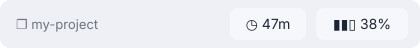
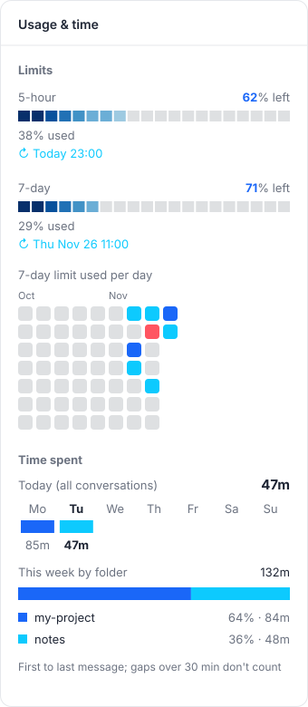

<div align="center">


&nbsp;&nbsp;

&nbsp;&nbsp;


# Claude Code Mods (TCAN Edition)

### Give the Claude you work with every day a touch of climate action

[](./LICENSE)


[繁體中文](./README.md) · **English**

</div>

> Translated from the Traditional Chinese version. If the two differ, the Traditional Chinese page is authoritative.

Five mods for Claude Code and the Claude desktop app. Install all of them or just the ones you want. None of them **use any tokens**: they only draw on your screen and read numbers Claude Code already has, and nothing is uploaded. Their text comes in **Traditional Chinese and English** and follows your system language by default.

<p align="center"></p>

---

## Contents

| | Section | In one line |
|---|---|---|
| 1 | [What's inside](#1-whats-inside) | Theme, CAN, usage limits, time spent, folder label |
| 2 | [Requirements](#2-requirements) | Claude Code 2.1+; no tokens used |
| 3 | [Install](#3-install) | Download → add the marketplace → install what you want |
| 4 | [Settings](#4-settings) | UI language: auto / 繁中 / English |
| 5 | [How it works](#5-how-it-works) | When each mod appears and what you see |
| 6 | [Scope](#6-scope-whats-not-included) | Code and example images; nobody's usage data |
| 7 | [Remove or modify](#7-remove-or-modify) | Uninstall, change text and colors |
| 8 | [FAQ](#8-faq) | No limits shown; no CAN in the terminal |
| 9 | [Maintenance and issues](#9-maintenance-and-issues) | Occasional updates; reports welcome |
| 10 | [License](#10-license) | Code MIT; TCAN brand assets excluded |
| 11 | [Changelog](#11-changelog) | What changed in each update |

---

## 1. What's inside

| Mod | In one line | Where you see it | UI language |
| --- | --- | --- | --- |
| [**tcan-theme**](#tcan-theme) | Recolors the app in Taiwan Climate Action Network (TCAN) colors | Desktop app, mobile app | No text |
| [**guanguan-pixel**](#guanguan-pixel) | Pixel animations of CAN, the TCAN mascot: marches while Claude works, winks when done | Desktop app | 繁中・English |
| [**usage-meter**](#usage-meter) | How much of your 5-hour / 7-day limits is left, when they reset, and a daily-usage calendar | Desktop, mobile, VS Code, terminal | 繁中・English |
| [**usage-time**](#usage-time) | Time spent today, each day this week, and this week by folder | Desktop, mobile, VS Code, terminal | 繁中・English |
| [**folder-label**](#folder-label) | Shows the current conversation's folder above the prompt box, on the left | Desktop, mobile, VS Code, terminal | Symbol and folder name only |

---

## 2. Requirements

- The Claude desktop app (Code tab) or Claude Code 2.1 or later
- macOS, Windows or Linux
- Usage limits (usage-meter) only exist on subscription plans (Pro, Max, etc.)

---

## 3. Install

### 1. Get this folder

Download (or `git clone`) the whole repo to a place you **won't move**, such as Documents. Claude Code reads the mods straight from this folder, so don't move or delete it after installing.

```bash
git clone https://github.com/AcaciaCCC/claude-code-mods.git
```

### 2. Add the marketplace (once)

Replace `<folder path>` with this folder's full path (drag the folder into the terminal window to paste it):

```bash
claude plugin marketplace add "<folder path>"
```

### 3. Install the mods you want

```bash
claude plugin install tcan-theme@tcan-claude-mods
```

```bash
claude plugin install guanguan-pixel@tcan-claude-mods
```

```bash
claude plugin install usage-meter@tcan-claude-mods
```

```bash
claude plugin install usage-time@tcan-claude-mods
```

```bash
claude plugin install folder-label@tcan-claude-mods
```

**Start a new conversation** and it takes effect; every new conversation after that has it too.

<details>
<summary>Other ways to install</summary>

- **Claude desktop app**: click **+** next to the prompt box → **Plugins** → **Add marketplace**, paste the folder path, then click **Add plugin** on the mods you want.
- **Claude Code in a terminal**: type `/plugin marketplace add <folder path>`, then `/plugin install tcan-theme@tcan-claude-mods`. (The desktop app's Code tab doesn't support `/plugin`.)
- **`claude` command not found**: you're using the Claude Code built into the desktop app. Ask Claude to run the commands above for you.

</details>

---

## 4. Settings

### UI language

CAN, usage-meter and usage-time have text, in **Traditional Chinese** and **English**.

| Value | Effect |
| --- | --- |
| `auto` (default) | Follows your system: Chinese systems get Traditional Chinese, everything else English |
| `zh-Hant` | Always Traditional Chinese |
| `en` | Always English |

**How to change it**: in Claude Code in a terminal, type `/config` and find the “介面語言 / UI language” row (one per mod). Or ask Claude to change it for you. It takes effect right away.

tcan-theme and folder-label have no text to translate, so they don't have this setting.

---

## 5. How it works

<a id="tcan-theme"></a>
### 1. TCAN theme (tcan-theme)

Recolors the Claude desktop app in TCAN colors, light mode only.

| Color | Hex | Used for |
| --- | --- | --- |
| TCAN blue | `#1D5BD0` | Buttons, links, toggles, selection, focus rings, Git additions |
| Navy | `#000066` | Pro badges, Git merges |
| Sky blue | `#1B87B0` | Git modifications |
| Warming red | `#E04A56` | Errors, deletions, Git removals |
| Pale TCAN blue | `#E6EDF8` | Sidebar |
| Blue-tinted off-white | `#F8F9FC` | Conversation |

- Code blocks use the `github-light` highlighting (blue, navy, red); where the app doesn't offer it, colors derived from TCAN's are used.
- A theme can't change fonts or layout, and Claude Code in a terminal or editor isn't recolored.
- If the status line says `no attached desktop or mobile client draws themes yet`, the app just wasn't connected yet when the theme was sent. The theme still applies; you can ignore it.

Details: [plugins/tcan-theme/README.en.md](plugins/tcan-theme/README.en.md)

<a id="guanguan-pixel"></a>
### 2. CAN pixel animations (guanguan-pixel)

CAN, the TCAN mascot (a little can with warming stripes), as pixel animations in the Claude desktop app. CAN doesn't stay on screen; it only shows up at these moments:

| When | What you see (English / 繁中) | Animation |
| --- | --- | --- |
| Claude is working | The working row shows CAN marching, with a line that changes by tool: CAN is thinking… / 罐罐思考中…, CAN is running a command… / 罐罐跑指令中… |  |
| A tool is running | The row's dots become a small marching CAN, the tool's description and CAN's line |  |
| First message of the day | CAN appears above the prompt box: “CAN says hi! Let's act on climate together 🌍” / 「罐罐說你好！一起為氣候採取行動 🌍」, 6 s |  |
| Claude finishes | CAN winks: “Done! ✨” / 「搞定！✨」, 4 s |  |
| Your message mentions “TCAN” (any case) | A pixel TCAN icon pops up, 8 s, no text |  |
| Claude runs over 1 minute | A pixel Earth spins: “Taking a while—let the Earth spin~” / 「跑好久了，地球轉一下～」, 8 s, then once a minute |  |

“Of the day” uses your computer's local time.

<p align="center"></p>

Details: [plugins/guanguan-pixel/README.en.md](plugins/guanguan-pixel/README.en.md)

<a id="usage-meter"></a>
### 3. Usage limits (usage-meter)

> “All I really want to know is how much of the 5-hour and 7-day limits is left, and when each resets.”

A button appears above the prompt box, on the right: `[ ▮▮▯ 38% ]`

- `38%` is how much of the 5-hour limit you've used. The three-cell battery follows whichever limit has **less left** (three cells above 70%, two above 40%, one above 10%).
- Click it to open the Usage widget; the button then reads “Close”. Or type `/usage-meter`.

In the widget:

- **5-hour, 7-day**: how much is left in large type, a **warming-stripes bar** (20 cells, dark blue → dark red) for the part used, and the reset time below.
- **7-day limit used per day**: a calendar like GitHub's contribution graph. Each column is a week, Monday to Sunday top to bottom; hover a square for the date and %.

| Square color | Meaning |
| --- | --- |
| Grey | 0 |
| Light blue `#0DCAFE` | Up to 10% |
| Blue `#1A67F8` | 10–20% |
| Red `#FF5561` | Over 20% |

- The calendar **starts recording when you install the mod**: each rise in the 7-day reading counts toward that day, so it can be slightly off.
- It works in a terminal too, where the calendar is drawn with square blocks instead of rounded ones.

Details: [plugins/usage-meter/README.en.md](plugins/usage-meter/README.en.md)

<a id="usage-time"></a>
### 4. Time spent (usage-time)

A button above the prompt box, on the right: `[ ◷ 47m ]`. `47m` is the minutes spent in this conversation. Click it to open the Time spent widget, or type `/usage-time`.

- **Today (all conversations)**: every conversation added up; time when two were open at once counts once.
- **This week, day by day**: Monday to Sunday, left to right, with the weekday on top, a colored bar in the middle and minutes below.
- **This week by folder**: the week's total next to the heading, then a split bar and each folder's percentage and minutes (top three in blue, light blue and red; the rest grouped as “Other” in grey).

| Bar color | Meaning |
| --- | --- |
| Grey | 0 |
| Light blue `#0DCAFE` | Under 1 hour |
| Blue `#1A67F8` | 1–2 hours |
| Red `#FF5561` | 2 hours or more |

**How time is counted**: from your first message to your last. If more than 30 minutes pass between two messages, you're treated as away and that gap doesn't count.

Details: [plugins/usage-time/README.en.md](plugins/usage-time/README.en.md)

#### usage-meter and usage-time together

With both installed, the two buttons **sit side by side**, with the conversation's folder on the left:

<p align="center"></p>

- Each button opens its own part. With both open, they share one widget, “Usage & time”: limits on top, time spent below.
- Closing the widget with its × resets both buttons.

<p align="center"></p>
<p align="center"><sub>Illustration (example numbers): “Usage & time” with both buttons open</sub></p>

<a id="folder-label"></a>
### 5. Folder label (folder-label)

> “Once I sorted the sidebar into my own groups, I couldn't tell which folder a conversation was in.”

Shows the conversation's folder above the prompt box, on the left (last part of the path only), such as `❐ my-project`.

- **Just the folder, no usage**: install folder-label alone.
- **With usage-meter**: usage-meter draws the folder name at the left of its button row, and folder-label steps aside so it doesn't appear twice.

Details: [plugins/folder-label/README.en.md](plugins/folder-label/README.en.md)

---

## 6. Scope: what's not included

| | Contents |
|---|---|
| ✅ **Included** | The five mods' code and tests, the generators for CAN's and the Earth's pixel art (`plugins/guanguan-pixel/tools/`), and the generator for the README illustrations (`docs/mockups/`) |
| ❌ **Not included** | Anyone's usage or time records (they stay on each person's computer), the author's development notes, TCAN's original brand design files |

All images in this README are **illustrations with example numbers**, not real usage.

---

## 7. Remove or modify

### Remove

```bash
claude plugin uninstall <mod name>@tcan-claude-mods
```

### Modify

- **Text**: each mod's UI text is in `plugins/<mod>/hooks/strings.ts`, Chinese and English side by side.
- **Colors**: `PALETTE` at the top of each mod's `hooks/register.tsx` (`register.ts` for the theme).
- **Pixel art**: in `plugins/guanguan-pixel/`, run:

```bash
{ python3 tools/gen2.py ts; python3 tools/earth.py ts; python3 tools/logo.py ts; } > hooks/sprite.ts
```

Then type `/reload-plugins` in Claude Code; no reinstall needed.

Validate and test (replace `<mod>` with the folder name):

```bash
claude plugin validate plugins/<mod>
```

```bash
claude plugin test plugins/<mod>
```

Folder layout:

```
claude-code-mods/
├── .claude-plugin/marketplace.json   # the five mods (marketplace name: tcan-claude-mods)
├── plugins/
│   ├── tcan-theme/       # theme
│   ├── guanguan-pixel/   # CAN animations (tools/ draws the pixel art)
│   ├── usage-meter/      # usage limits
│   ├── usage-time/       # time spent
│   └── folder-label/     # folder label
└── docs/
    ├── images/           # pixel art and illustrations for the README
    └── mockups/          # illustration generator
```

---

## 8. FAQ

<details>
<summary>The widget keeps saying “Limits appear after the next reply”</summary>

Limits only show up after Claude replies once. If you use an API key rather than a subscription plan, there are no limits to show.

</details>

<details>
<summary>I don't see CAN or the theme in the terminal</summary>

CAN and the theme are drawn only in the Claude desktop app (the theme also in the mobile app); Claude Code in a terminal or editor doesn't show them. usage-meter, usage-time and folder-label work in the terminal too.

</details>

<details>
<summary>How do I switch the text to Chinese?</summary>

See [4. Settings](#4-settings) and set “UI language” to `zh-Hant`.

</details>

---

## 9. Maintenance and issues

These are tools the author uses every day, **not a full-time maintained product**:

- **Updates**: synced here from time to time after the author changes their own copy.
- **Issues**: read, but replies may be slow. Reports with your OS, Claude version and a screenshot get looked at first.
- **Translations**: if the English reads oddly, or you'd like another language, PRs to `strings.ts` are welcome.

---

## 10. License

| Part | License | In short |
| --- | --- | --- |
| **Code** (`plugins/`, `docs/mockups/`) | [MIT](./LICENSE) | Use, modify and sell freely; keep the LICENSE file |
| **TCAN brand assets**: CAN's design, the TCAN icon, the color palette | © Taiwan Climate Action Network (TCAN) | For display in these mods only; ask TCAN before using them elsewhere |

CAN's design is based on the LINE sticker set 「罐罐說你好」; the TCAN icon and colors come from [tcan2050.org.tw](https://tcan2050.org.tw).

---

## 11. Changelog

### 2026-11-22

**New**
- **English UI**: CAN (the TCAN mascot), usage-meter and usage-time now come in Traditional Chinese and English. In `/config`, set “介面語言 / UI language” to `auto` (follow the system, default), `zh-Hant` or `en`.
- **New mod: folder-label**: shows the conversation's folder above the prompt box, on the left.
- **usage-meter**: with usage-time installed, the button row also shows the folder name on the left.

**Changed**
- CAN's once-a-day hello now uses your computer's local time (it used to be fixed to Taiwan time).
- usage-meter's buttons still show when the folder path can't be read (the whole row used to disappear).
- All UI text now lives in each mod's `hooks/strings.ts`, so wording can change without touching the code.

**Docs**
- The README now comes in Traditional Chinese ([README.md](./README.md)) and English ([README.en.md](./README.en.md)), and so does each mod's folder.
- Images are now illustrations with example numbers; screenshots and development notes with the author's real usage were removed.
- Added the [MIT license](./LICENSE), with a note on TCAN's brand assets.

### 2026-11-17

- First release: TCAN theme, CAN pixel animations, usage-meter, usage-time.
