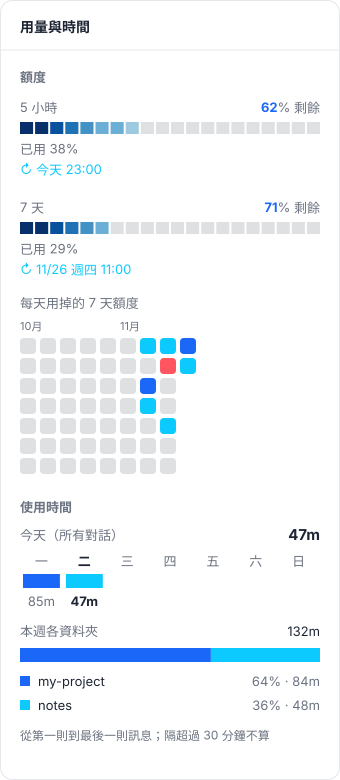

<div align="center">


&nbsp;&nbsp;

&nbsp;&nbsp;


# Claude Code 小工具合輯（TCAN 版）

### 讓每天陪你工作的 Claude，也帶一點氣候行動的顏色

[](./LICENSE)


**繁體中文** · [English](./README.en.md)

</div>

> 本頁以繁體中文版為準；英文版由同一份內容翻譯，如有出入以本頁為準。

五個裝在 Claude Code／Claude 桌面 App 上的 mod，可以全部裝，也可以只挑想要的。五個都**不耗費任何 token**：只在你的電腦上畫畫面、讀 Claude Code 本來就有的數字，資料不會上傳。介面文字有**繁體中文與英文**，預設跟著系統語言。

<p align="center"></p>

---

## 目錄

| | 章節 | 一句話 |
|---|---|---|
| 一 | [有哪些 mod](#一有哪些-mod) | 主題、罐罐、額度、使用時間、資料夾標籤 |
| 二 | [需求](#二需求) | Claude Code 2.1 以上；不耗 token |
| 三 | [安裝](#三安裝) | 下載 → 加入 marketplace → 挑想要的裝 |
| 四 | [設定](#四設定) | 介面語言：自動／繁中／English |
| 五 | [使用方式](#五使用方式) | 每個 mod 什麼時候出現、看到什麼 |
| 六 | [開放範圍](#六開放範圍什麼不在裡面) | 包含程式與範例圖；不含任何人的使用紀錄 |
| 七 | [移除與修改](#七移除與修改) | 解除安裝、改文字和顏色 |
| 八 | [常見問題](#八常見問題) | 額度沒出現、終端機看不到罐罐 |
| 九 | [維護與回報](#九維護與回報) | 不定期更新、歡迎回報 |
| 十 | [授權](#十授權) | 程式 MIT；TCAN 識別另計 |
| 十一 | [更新紀錄](#十一更新紀錄) | 每次更新改了什麼 |

---

## 一、有哪些 mod

| mod | 一句話 | 在哪裡看得到 | 介面語言 |
| --- | --- | --- | --- |
| [**tcan-theme**](#1-tcan-主題tcan-theme) | 把介面換成 TCAN 台灣氣候行動網絡的配色 | 桌面 App、手機 App | 沒有文字 |
| [**guanguan-pixel**](#2-罐罐像素動畫guanguan-pixel) | 吉祥物「罐罐」的像素動畫，工作時踏步、做完會眨眼 | 桌面 App | 繁中・English |
| [**usage-meter**](#3-額度usage-meter) | 5 小時／7 天額度還剩多少、何時重置、每天用量月曆 | 桌面 App、手機、VS Code、終端機 | 繁中・English |
| [**usage-time**](#4-使用時間usage-time) | 今天、本週每天、本週各資料夾花了多少時間 | 桌面 App、手機、VS Code、終端機 | 繁中・English |
| [**folder-label**](#5-資料夾標籤folder-label) | 輸入框上方左邊顯示這個對話所在的資料夾 | 桌面 App、手機、VS Code、終端機 | 只有符號與資料夾名 |

---

## 二、需求

- Claude 桌面 App（Code 分頁）或 Claude Code 2.1 以上
- macOS、Windows、Linux 都可以
- 額度（usage-meter）只有訂閱方案（Pro／Max 等）才有資料

---

## 三、安裝

### 1. 取得這個資料夾

把整個 repo 下載（或 `git clone`）到電腦上一個**不會移動**的地方，例如「文件」裡面。Claude Code 會直接從這個資料夾讀 mod，裝好之後請不要搬動或刪除它。

```bash
git clone https://github.com/AcaciaCCC/claude-code-mods.git
```

### 2. 加入 marketplace（只要做一次）

`<資料夾路徑>` 換成這個資料夾的完整路徑（把資料夾拖進終端機視窗，路徑會自動填上）：

```bash
claude plugin marketplace add "<資料夾路徑>"
```

### 3. 安裝想要的 mod

```bash
claude plugin install tcan-theme@tcan-claude-mods
```

```bash
claude plugin install guanguan-pixel@tcan-claude-mods
```

```bash
claude plugin install usage-meter@tcan-claude-mods
```

```bash
claude plugin install usage-time@tcan-claude-mods
```

```bash
claude plugin install folder-label@tcan-claude-mods
```

裝好後**開一個新對話**就會生效，之後每個新對話都會自動套用。

<details>
<summary>其他安裝方式</summary>

- **Claude 桌面 App**：輸入框旁的 **+** → **Plugins** → **Add marketplace**，貼上資料夾路徑，再對想要的 mod 按 **Add plugin**。
- **終端機版 Claude Code**：輸入 `/plugin marketplace add <資料夾路徑>`，再 `/plugin install tcan-theme@tcan-claude-mods`。（桌面 App 的 Code 分頁不支援 `/plugin`。）
- **終端機打 `claude` 找不到指令**：代表你用的是桌面 App 內建的 Claude Code，直接請 Claude 幫你執行上面的指令。

</details>

---

## 四、設定

### 介面語言

罐罐、額度、使用時間三個 mod 有文字，都提供**繁體中文**與 **English**。

| 值 | 效果 |
| --- | --- |
| `auto`（預設） | 跟著系統語言：中文系統顯示繁中，其他顯示英文 |
| `zh-Hant` | 固定繁體中文 |
| `en` | 固定英文 |

**怎麼改**：在終端機版 Claude Code 輸入 `/config`，找到「介面語言 / UI language」那一列（每個 mod 各一列）。也可以直接請 Claude 幫你改。改完會立刻套用。

tcan-theme 和 folder-label 沒有需要翻譯的文字，所以沒有這個設定。

---

## 五、使用方式

### 1. TCAN 主題（tcan-theme）

把 Claude 桌面版介面換成 TCAN 配色，固定淺色模式。

| 顏色 | 色碼 | 用在哪裡 |
| --- | --- | --- |
| TCAN 藍 | `#1D5BD0` | 按鈕、連結、開關、選取狀態、焦點框、Git 新增 |
| 深藍 | `#000066` | 進階標示、Git 合併 |
| 天藍 | `#1B87B0` | Git 修改 |
| 暖化紅 | `#E04A56` | 錯誤、刪除、Git 刪除 |
| 淡 TCAN 藍 | `#E6EDF8` | 左側欄 |
| 帶藍灰白 | `#F8F9FC` | 對話頁面 |

- 程式碼區塊用 `github-light` 配色（藍、深藍、紅）；App 不提供時改用 TCAN 色延伸的配色。
- 字體與版面無法用主題更改；終端機與編輯器裡的 Claude Code 不會變色。
- 狀態列若顯示 `no attached desktop or mobile client draws themes yet`，只表示主題送出時 App 還沒接上，主題仍會套用，可忽略。

詳細說明：[plugins/tcan-theme/README.md](plugins/tcan-theme/README.md)

### 2. 罐罐像素動畫（guanguan-pixel）

把 TCAN 吉祥物「罐罐」（身上有增溫條的小罐頭）做成像素動畫，放進 Claude 桌面 App。罐罐平常不會一直待在畫面上，只在下面這些時刻出現：

| 時機 | 畫面（繁中／English） | 動畫 |
| --- | --- | --- |
| Claude 工作中 | 「運作中」那一列換成踏步的罐罐，台詞跟著工具變：罐罐思考中…／CAN is thinking…、罐罐跑指令中…／CAN is running a command… |  |
| 執行中的工具列 | 原本的點點換成踏步小罐罐＋工具描述＋罐罐台詞 |  |
| 每天第一則訊息 | 輸入框上方置中出現罐罐：「罐罐說你好！一起為氣候採取行動 🌍」／“CAN says hi! Let's act on climate together 🌍”，6 秒 |  |
| Claude 做完事 | 罐罐「>」眨眼：「搞定！✨」／“Done! ✨”，4 秒 |  |
| 訊息裡有「TCAN」（不分大小寫） | 置中跳出像素 TCAN 圖示，8 秒，沒有文字 |  |
| Claude 跑超過 1 分鐘 | 像素地球快轉：「跑好久了，地球轉一下～」／“Taking a while—let the Earth spin~”，8 秒，之後每分鐘一次 |  |

「每天」以你電腦的當地時間計算。

<p align="center"></p>

詳細說明：[plugins/guanguan-pixel/README.md](plugins/guanguan-pixel/README.md)

### 3. 額度（usage-meter）

> 「我其實只是想知道 5 小時剩多少，7 天剩多少，分別什麼時候重置。」

輸入框右上方會出現一顆按鈕 `[ ▮▮▯ 38% ]`：

- `38%` 是 5 小時額度已用多少；三格電量依兩個額度中**剩比較少**的那個亮格（>70% 三格、>40% 兩格、>10% 一格）。
- 點一下打開「用量」小工具，按鈕變成「收起」。也可以輸入 `/usage-meter`。

小工具內容：

- **5 小時、7 天**：大字寫剩幾 %，下面的**增溫條**（20 格，深藍 → 深紅）代表已用的部分，再下面寫重置時間。
- **每天用掉的 7 天額度**：像 GitHub 貢獻圖的月曆，每一欄一週、由上到下是週一到週日，滑鼠移到格子上會顯示日期和 %。

| 格子顏色 | 意思 |
| --- | --- |
| 灰 | 0 |
| 淺藍 `#0DCAFE` | 10% 以內 |
| 深藍 `#1A67F8` | 10–20% |
| 紅 `#FF5561` | 超過 20% |

- 月曆**從安裝那一刻開始記錄**：每次額度讀數增加的部分算進當天，可能有一點誤差。
- 終端機版也能用，但月曆會用方塊排，沒有圓角。

詳細說明：[plugins/usage-meter/README.md](plugins/usage-meter/README.md)

### 4. 使用時間（usage-time）

輸入框右上方的按鈕 `[ ◷ 47m ]`：`47m` 是這次對話用了幾分鐘。點一下打開「使用時間」小工具，也可以輸入 `/usage-time`。

- **今天（所有對話）**：所有對話加起來，兩個對話同時開著的時間只算一次。
- **本週每天**：週一到週日由左到右，上面星期、中間顏色格、下面分鐘數。
- **本週各資料夾**：標題右邊是本週總時間；下面一條分色長條加上每個資料夾的百分比與分鐘數（前三名藍、青藍、紅，其餘「其他」灰）。

| 格子顏色 | 意思 |
| --- | --- |
| 灰 | 0 |
| 淺藍 `#0DCAFE` | 1 小時內 |
| 深藍 `#1A67F8` | 1–2 小時 |
| 紅 `#FF5561` | 2 小時以上 |

**時間怎麼算**：從第一則訊息算到最後一則訊息；兩則之間隔超過 30 分鐘，就當作你離開了，那段不算。

詳細說明：[plugins/usage-time/README.md](plugins/usage-time/README.md)

#### 額度＋使用時間一起裝

兩個都裝時，兩顆按鈕會**並排在同一行**，左邊是這個對話所在的資料夾：

<p align="center"></p>

- 兩顆各自開關；兩個都打開時是同一個小工具「用量與時間」，上面額度、下面使用時間。
- 用小工具的 × 關掉時，兩顆按鈕都會回到收起狀態。

<p align="center"></p>
<p align="center"><sub>示意圖（範例數字）：兩顆按鈕都打開時的「用量與時間」</sub></p>

### 5. 資料夾標籤（folder-label）

> 側邊欄改用自訂分組後，看不出對話在哪個資料夾。

輸入框上方左邊顯示這個對話所在的資料夾（只寫最後一層名稱），例如 `❐ my-project`。

- **只想要資料夾、不要用量**：只裝 folder-label 就好。
- **跟 usage-meter 一起裝**：資料夾名稱由 usage-meter 畫在按鈕那一行的左邊，folder-label 自動不顯示，不會出現兩次。

詳細說明：[plugins/folder-label/README.md](plugins/folder-label/README.md)

---

## 六、開放範圍：什麼不在裡面

| | 內容 |
|---|---|
| ✅ **包含** | 五個 mod 的程式、測試、罐罐與地球的像素圖產生程式（`plugins/guanguan-pixel/tools/`）、README 示意圖的產生程式（`docs/mockups/`） |
| ❌ **不包含** | 任何人的用量或使用時間紀錄（都只存在各自的電腦上）、作者的開發筆記、TCAN 識別的原始設計檔 |

README 的圖都是用**範例數字**畫的示意圖，不是真實用量。

---

## 七、移除與修改

### 移除

```bash
claude plugin uninstall <mod 名稱>@tcan-claude-mods
```

### 修改

- **文字**：每個 mod 的介面文字都在 `plugins/<mod>/hooks/strings.ts`，中英文放在一起。
- **顏色**：在各 mod `hooks/register.tsx`（主題是 `register.ts`）最上面的 `PALETTE`。
- **像素圖**：在 `plugins/guanguan-pixel/` 執行：

```bash
{ python3 tools/gen2.py ts; python3 tools/earth.py ts; python3 tools/logo.py ts; } > hooks/sprite.ts
```

改完在 Claude Code 輸入 `/reload-plugins` 就會套用，不用重新安裝。

驗證與測試（`<mod>` 換成資料夾名稱）：

```bash
claude plugin validate plugins/<mod>
```

```bash
claude plugin test plugins/<mod>
```

資料夾結構：

```
claude-code-mods/
├── .claude-plugin/marketplace.json   # 五個 mod 的清單（marketplace 名稱：tcan-claude-mods）
├── plugins/
│   ├── tcan-theme/       # 主題
│   ├── guanguan-pixel/   # 罐罐像素動畫（含 tools/ 像素圖產生程式）
│   ├── usage-meter/      # 額度
│   ├── usage-time/       # 使用時間
│   └── folder-label/     # 資料夾標籤
└── docs/
    ├── images/           # README 用的像素圖與示意圖
    └── mockups/          # 示意圖產生程式
```

---

## 八、常見問題

<details>
<summary>額度一直顯示「下一次回覆後顯示額度」</summary>

額度資料要等 Claude 回覆一次才會出現；如果你用的是 API 金鑰而不是訂閱方案，就沒有額度資料。

</details>

<details>
<summary>終端機裡看不到罐罐和主題</summary>

罐罐和主題只畫在 Claude 桌面 App（主題也包含手機 App）；終端機與編輯器裡的 Claude Code 不會顯示。額度、使用時間、資料夾標籤在終端機也能用。

</details>

<details>
<summary>想把介面換成英文</summary>

見[四、設定](#四設定)，把「介面語言」改成 `en`。

</details>

---

## 九、維護與回報

這是作者自己每天在用的工具，**不是全職維護的產品**，先說清楚：

- **更新**：作者改了自己的版本後，會不定期同步到這裡。
- **Issue**：會看，但回覆可能不及時；附上作業系統、Claude 版本和截圖的問題優先處理。
- **翻譯**：英文翻得不自然、或想加其他語言，歡迎開 PR 改 `strings.ts`。

---

## 十、授權

| 內容 | 授權 | 簡單說 |
| --- | --- | --- |
| **程式碼**（`plugins/`、`docs/mockups/`） | [MIT](./LICENSE) | 拿去用、改、商用都可以，保留 LICENSE 即可 |
| **TCAN 識別**：罐罐造型、TCAN 圖示、配色 | 著作權歸 TCAN 台灣氣候行動網絡所有 | 僅供這些 mod 顯示使用；要用在其他地方請先與 TCAN 確認 |

罐罐造型參考 LINE 貼圖「罐罐說你好」，TCAN 圖示與配色取自 [tcan2050.org.tw](https://tcan2050.org.tw)。

---

## 十一、更新紀錄

### 2026-11-22

**新功能**
- **英文介面**：罐罐、額度、使用時間三個 mod 的文字都有繁體中文與英文，在 `/config` 的「介面語言 / UI language」選 `auto`（跟著系統，預設）、`zh-Hant` 或 `en`。罐罐的英文名是 **CAN**。
- **新 mod：資料夾標籤（folder-label）**：輸入框上方左邊顯示這個對話所在的資料夾。
- **額度**：跟使用時間一起裝時，按鈕那一行的左邊也會顯示資料夾名稱。

**調整**
- 罐罐的「每天第一則訊息」招呼，改用電腦的當地時間計算（原本固定台灣時間）。
- 額度讀不到資料夾路徑時，按鈕照常顯示（原本會整行不見）。
- 介面文字集中到各 mod 的 `hooks/strings.ts`，改字不用動程式。

**說明文件**
- README 改成繁中（[README.md](./README.md)）與英文（[README.en.md](./README.en.md)）兩版，每個 mod 資料夾也有中英說明。
- 圖片改成用範例數字畫的示意圖；移除含作者實際用量的截圖與開發筆記。
- 加上 [MIT 授權](./LICENSE)，並註明 TCAN 識別的著作權。

### 2026-11-17

- 首次發布：TCAN 主題、罐罐像素動畫、額度、使用時間。
