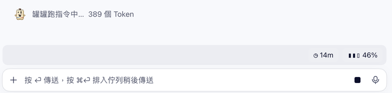
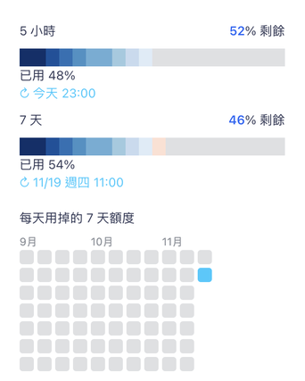
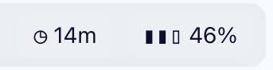
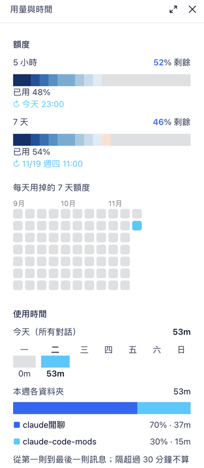

# Claude Code 小工具合集（TCAN 版）

四個裝在 Claude Code／Claude 桌面 App 上的 mod，可以全部裝，也可以只挑想要的。

<p align="center">
  
  &nbsp;&nbsp;
  
  &nbsp;&nbsp;
  
</p>

| mod | 一句話 | 在哪裡看得到 |
| --- | --- | --- |
| [**tcan-theme**](#1-tcan-主題tcan-theme) | 把介面換成 TCAN 台灣氣候行動網絡的配色 | 桌面 App、手機 App |
| [**guanguan-pixel**](#2-罐罐像素動畫guanguan-pixel) | 吉祥物「罐罐」的像素動畫，工作時踏步、做完會眨眼 | 桌面 App |
| [**usage-meter**](#3-額度usage-meter) | 5 小時／7 天額度還剩多少、何時重置、每天用量月曆 | 桌面 App、手機、VS Code、終端機 |
| [**usage-time**](#4-使用時間usage-time) | 今天、本週每天、本週各資料夾花了多少時間 | 桌面 App、手機、VS Code、終端機 |

四個 mod 都**不耗費任何 token**：只在你的電腦上畫畫面、讀 Claude Code 本來就有的數字，資料不會上傳。

---

## 安裝

### 1. 取得這個資料夾

把整個 repo 下載（或 `git clone`）到電腦上一個**不會移動**的地方，例如「文件」裡面。
Claude Code 會直接從這個資料夾讀 mod，裝好之後請不要搬動或刪除它。

### 2. 加入 marketplace（只要做一次）

在終端機執行，`<資料夾路徑>` 換成這個資料夾的完整路徑（把資料夾拖進終端機視窗，路徑會自動填上）：

```bash
claude plugin marketplace add "<資料夾路徑>"
```

### 3. 安裝想要的 mod

```bash
claude plugin install tcan-theme@tcan-claude-mods
```

```bash
claude plugin install guanguan-pixel@tcan-claude-mods
```

```bash
claude plugin install usage-meter@tcan-claude-mods
```

```bash
claude plugin install usage-time@tcan-claude-mods
```

裝好後**開一個新對話**就會生效，之後每個新對話都會自動套用。

<details>
<summary>其他安裝方式</summary>

- **終端機版 Claude Code 的輸入框**：
  ```
  /plugin marketplace add <資料夾路徑>
  /plugin install tcan-theme@tcan-claude-mods
  ```
  （桌面 App 的 Code 分頁不支援 `/plugin`。）
- **Claude 桌面 App**：輸入框旁的 **+** → **Plugins** → **Add marketplace**，貼上資料夾路徑，再對想要的 mod 按 **Add plugin**。
- **終端機打 `claude` 找不到指令**：代表你用的是桌面 App 內建的 Claude Code。把 `claude` 換成 App 內建程式的完整路徑，或直接請 Claude 幫你執行上面的指令。

</details>

### 移除

```bash
claude plugin uninstall <mod 名稱>@tcan-claude-mods
```

### 修改

每個 mod 的程式都在 `plugins/<mod 名稱>/hooks/` 裡。改完之後在 Claude Code 輸入 `/reload-plugins` 就會套用，不用重新安裝。

---

## 1. TCAN 主題（tcan-theme）

把 Claude 桌面版介面換成 TCAN 配色，固定淺色模式。

| 顏色 | 色碼 | 用在哪裡 |
| --- | --- | --- |
| TCAN 藍 | `#1D5BD0` | 按鈕、連結、開關、選取狀態、焦點框、Git 新增 |
| 深藍 | `#000066` | 進階標示、Git 合併 |
| 天藍 | `#1B87B0` | Git 修改 |
| 暖化紅 | `#E04A56` | 錯誤、刪除、Git 刪除 |
| 淡 TCAN 藍 | `#E6EDF8` | 左側欄 |
| 帶藍灰白 | `#F8F9FC` | 對話頁面 |

- 程式碼區塊用 `github-light` 配色（藍、深藍、紅）；App 不提供時改用 TCAN 色延伸的配色。
- 字體與版面無法用主題更改；終端機與編輯器裡的 Claude Code 不會變色。
- 狀態列若顯示 `no attached desktop or mobile client draws themes yet`，只表示主題送出時 App 還沒接上，主題仍會套用，可忽略。
- 顏色都在 [`plugins/tcan-theme/hooks/register.ts`](plugins/tcan-theme/hooks/register.ts)。

詳細說明：[plugins/tcan-theme/README.md](plugins/tcan-theme/README.md)

---

## 2. 罐罐像素動畫（guanguan-pixel）

把 TCAN 吉祥物「罐罐」（身上有增溫條的小罐頭）做成像素動畫，放進 Claude 桌面 App。
罐罐平常不會一直待在畫面上，只在下面這些時刻出現：

<p align="center"></p>
<p align="center"><sub>實機截圖：Claude 跑指令時，「運作中」那一列換成罐罐與台詞</sub></p>

| 時機 | 畫面 | 動畫 |
| --- | --- | --- |
| Claude 工作中 | 「運作中」那一列換成踏步的罐罐，台詞跟著工具變：罐罐思考中…、罐罐跑指令中…、罐罐翻資料中…、罐罐上網查資料… |  |
| 執行中的工具列 | 原本的橘色點點換成踏步小罐罐＋工具描述＋罐罐台詞 |  |
| 每天第一則訊息（台灣時間） | 輸入框上方置中出現罐罐，泡泡說「罐罐說你好！一起為氣候採取行動 🌍」，6 秒 |  |
| Claude 做完事 | 罐罐「>」眨眼，泡泡說「搞定！✨」，4 秒 |  |
| 訊息裡有「TCAN」（不分大小寫） | 置中跳出像素 TCAN 圖示，8 秒，沒有文字 |  |
| Claude 跑超過 1 分鐘 | 像素地球快轉，「跑好久了，地球轉一下～」，8 秒，之後每分鐘一次 |  |

**罐罐造型**：大小眼（左小右大、瘦長），嘴巴是上白下黑的直立長橢圓；「>」眨眼只在特殊時刻出現。

<p align="center"></p>

**可以改的地方**（都在 [`plugins/guanguan-pixel/hooks/register.tsx`](plugins/guanguan-pixel/hooks/register.tsx) 最上面）：

| 常數 | 意思 |
| --- | --- |
| `HELLO_MS` / `DONE_MS` / `TCAN_MS` | 招呼、搞定、TCAN 圖示各停留幾毫秒 |
| `LONG_MS` | 跑多久算「跑太久」 |
| `TCAN_WORDS` | 觸發 TCAN 圖示的關鍵字 |
| `TOOL_WORDS` | 各工具對應的罐罐台詞 |

像素圖由 `tools/` 裡的 Python 產生（`gen2.py` 罐罐、`earth.py` 地球、`logo.py` TCAN 圖示）。改完圖在 `plugins/guanguan-pixel/` 裡執行：

```bash
{ python3 tools/gen2.py ts; python3 tools/earth.py ts; python3 tools/logo.py ts; } > hooks/sprite.ts
```

詳細說明：[plugins/guanguan-pixel/README.md](plugins/guanguan-pixel/README.md)

---

## 3. 額度（usage-meter）

> 「我其實只是想知道 5 小時剩多少，7 天剩多少，分別什麼時候重置。」

輸入框右上方會出現一顆按鈕：

```
[ ▮▮▯ 28% ]
```

- `28%` 是 5 小時額度已用多少；三格電量依兩個額度中**剩比較少**的那個亮格（>70% 三格、>40% 兩格、>10% 一格）。
- 點一下打開「用量」小工具，按鈕變成「▮▮▯ 收起」。也可以輸入 `/usage-meter`。

小工具內容：

<p align="center"></p>

- **5 小時、7 天**：大字寫剩幾 %，下面的**增溫條**（20 格，深藍 → 深紅）代表已用的部分，再下面寫重置時間（今天 18:00／明天／11/21（五））。
- **每天用掉的 7 天額度**：像 GitHub 貢獻圖的月曆，每一欄一週、由上到下是週一到週日，滑鼠移到格子上會顯示日期和 %。

| 格子顏色 | 意思 |
| --- | --- |
| 灰 | 0 |
| 淺藍 `#0DCAFE` | 10% 以內 |
| 深藍 `#1A67F8` | 10–20% |
| 紅 `#FF5561` | 超過 20% |

**要知道的事**

- 只有訂閱方案（Pro／Max 等）才有額度資料，要等第一次回覆之後才會出現。
- 月曆**從安裝那一刻開始記錄**：每次額度讀數增加的部分算進當天，可能有一點誤差。
- 終端機版也能用，但月曆會用方塊排，沒有圓角。

設計與每次修改的原因：[plugins/usage-meter/DEVELOPMENT.md](plugins/usage-meter/DEVELOPMENT.md)

---

## 4. 使用時間（usage-time）

輸入框右上方的按鈕：

```
[ ◷ 83m ]
```

- `83m` 是這次對話用了幾分鐘。點一下打開「使用時間」小工具。也可以輸入 `/usage-time`。

小工具內容：

- **今天（所有對話）**：所有對話加起來，兩個對話同時開著的時間只算一次。
- **本週每天**：週一到週日由左到右，上面星期、中間顏色格、下面分鐘數。
- **本週各資料夾**：標題右邊是本週總時間；下面一條分色長條加上每個資料夾的百分比與分鐘數（前三名藍、青藍、紅，其餘「其他」灰）。

| 格子顏色 | 意思 |
| --- | --- |
| 灰 | 0 |
| 淺藍 `#0DCAFE` | 1 小時內 |
| 深藍 `#1A67F8` | 1–2 小時 |
| 紅 `#FF5561` | 2 小時以上 |

**時間怎麼算**：從第一則訊息算到最後一則訊息；兩則之間隔超過 30 分鐘，就當作你離開了，那段不算。

設計與每次修改的原因：[plugins/usage-time/DEVELOPMENT.md](plugins/usage-time/DEVELOPMENT.md)

### 額度 ＋ 使用時間一起裝

兩個都裝時，兩顆按鈕會**並排在同一行**：

<p align="center"></p>

```
[ ◷ 83m ] [ ▮▮▯ 28% ]
```

- 兩顆各自開關；兩個都打開時是同一個小工具「用量與時間」，上面額度、下面使用時間。
- 用小工具的 × 關掉時，兩顆按鈕都會回到收起狀態。

<p align="center"></p>
<p align="center"><sub>實機截圖：兩顆按鈕都打開時的「用量與時間」</sub></p>

---

## 資料夾結構

```
claude-code-mods/
├── .claude-plugin/marketplace.json   # 四個 mod 的清單（marketplace 名稱：tcan-claude-mods）
├── plugins/
│   ├── tcan-theme/       # 主題
│   ├── guanguan-pixel/   # 罐罐像素動畫（含 tools/ 像素圖產生程式）
│   ├── usage-meter/      # 額度
│   └── usage-time/       # 使用時間
└── docs/images/          # README 用的圖片
```

驗證與測試（`<mod>` 換成資料夾名稱）：

```bash
claude plugin validate plugins/<mod>
```

```bash
claude plugin test plugins/<mod>
```

---

## 版權與識別

罐罐造型參考 LINE 貼圖「罐罐說你好」，TCAN 圖示與配色取自 [tcan2050.org.tw](https://tcan2050.org.tw)，皆為 TCAN 台灣氣候行動網絡的識別。這個 repo 目前為私人；若要對外公開發佈，請先與 TCAN 確認。
