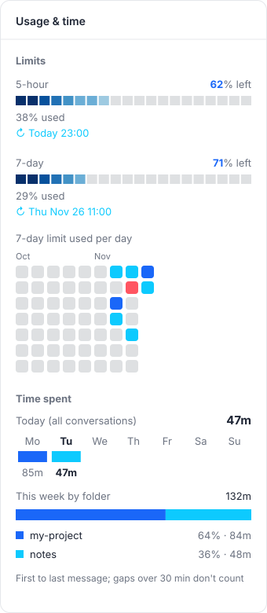

# Usage limits (usage-meter)

[繁體中文](./README.md) · **English**

A button above the prompt box, on the right, `[ ▮▮▯ 38% ]`. Open it to see how much of your 5-hour and 7-day limits is left, when they reset, and a calendar of how much of the 7-day limit you used each day. **Uses no tokens**; records stay on your computer.

<p align="center"></p>
<p align="center"><sub>Illustration (example numbers)</sub></p>

## What you see

- **The button**: `38%` is how much of the 5-hour limit is used; the battery follows whichever limit has less left. `/usage-meter` opens and closes it too.
- **5-hour, 7-day**: % left, a warming-stripes bar for the part used (dark blue → dark red), and the reset time.
- **7-day limit used per day**: one column per week, Monday to Sunday top to bottom; grey 0, light blue ≤10%, blue 10–20%, red >20%.
- **With usage-time**: the two buttons sit side by side with the folder on the left; with both open they share the “Usage & time” widget.

## Good to know

- Only subscription plans (Pro, Max, etc.) have limits, and they appear after Claude's first reply.
- The calendar starts recording when you install the mod; each rise in the 7-day reading counts toward that day, so it can be slightly off.
- It works in a terminal too, with square blocks for the calendar.

## UI language

In `/config`, set “介面語言 / UI language” to `auto` (follow the system, default), `zh-Hant` or `en`. All text is in [`hooks/strings.ts`](hooks/strings.ts).

## Install

Add the marketplace from the collection's root folder (the one with `.claude-plugin/marketplace.json`), then install. Full steps: [collection README](../../README.en.md#3-install).

```bash
claude plugin install usage-meter@tcan-claude-mods
```

## Remove

```bash
claude plugin uninstall usage-meter@tcan-claude-mods
```

## Modify

Colors: `PALETTE` and `STRIPES` at the top of [`hooks/register.tsx`](hooks/register.tsx). Text: [`hooks/strings.ts`](hooks/strings.ts). Tests: `claude plugin test plugins/usage-meter`.
