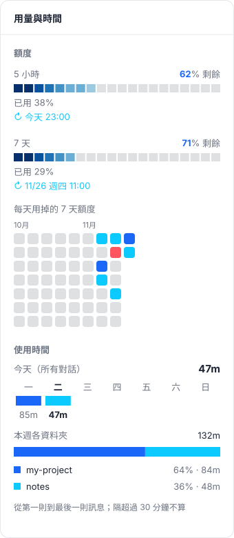

# 額度（usage-meter）

**繁體中文** · [English](./README.en.md)

輸入框右上方一顆按鈕 `[ ▮▮▯ 38% ]`，點開看 5 小時／7 天額度還剩多少、何時重置，以及每天用掉多少 7 天額度的月曆。**不耗費 token**，紀錄只存在你的電腦上。

<p align="center"></p>
<p align="center"><sub>示意圖（範例數字）</sub></p>

## 看到什麼

- **按鈕**：`38%` 是 5 小時額度已用多少；三格電量依兩個額度中剩比較少的那個亮格。也可以輸入 `/usage-meter` 開關。
- **5 小時、7 天**：剩幾 %、增溫條（已用的部分，深藍 → 深紅）、重置時間。
- **每天用掉的 7 天額度**：每一欄一週、由上到下週一到週日；灰 0、淺藍 ≤10%、深藍 10–20%、紅 >20%。
- **跟 usage-time 一起裝**：兩顆按鈕並排，左邊顯示資料夾；兩個都打開時合成「用量與時間」小工具。

## 要知道的事

- 只有訂閱方案（Pro／Max 等）才有額度資料，要等第一次回覆之後才會出現。
- 月曆從安裝那一刻開始記錄：每次 7 天讀數增加的部分算進當天，可能有一點誤差。
- 終端機也能用，月曆會用方塊排。

## 介面語言

在 `/config` 的「介面語言 / UI language」選 `auto`（跟著系統，預設）、`zh-Hant` 或 `en`。文字都在 [`hooks/strings.ts`](hooks/strings.ts)。

## 安裝

在合輯根目錄（有 `.claude-plugin/marketplace.json` 的那一層）加入 marketplace 後安裝，完整步驟見[合輯 README](../../README.md#三安裝)：

```bash
claude plugin install usage-meter@tcan-claude-mods
```

## 移除

```bash
claude plugin uninstall usage-meter@tcan-claude-mods
```

## 修改

顏色在 [`hooks/register.tsx`](hooks/register.tsx) 最上面的 `PALETTE`、`STRIPES`；文字在 [`hooks/strings.ts`](hooks/strings.ts)。測試：`claude plugin test plugins/usage-meter`。
